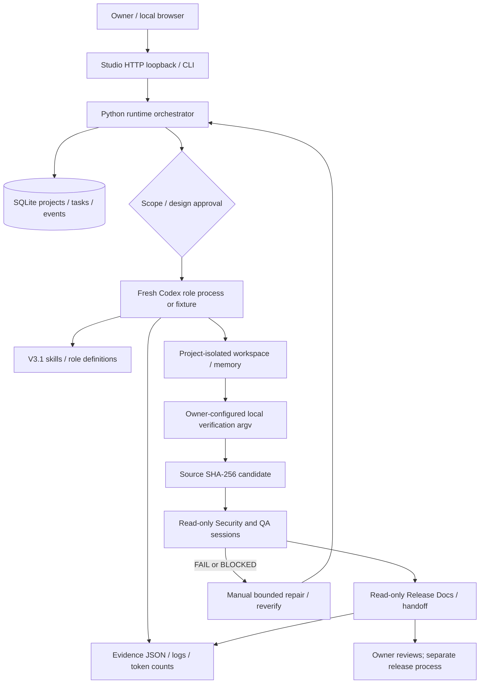

# Architecture — Roheen DevOS V4

The queue is persisted; every role claim runs inside a SQLite transaction, with a single active task per project. A role's execution is a fresh subprocess for the Codex adapter, not a simulated persona. Fixture mode is visibly labeled and never performs a provider call. The runtime does not expose arbitrary shell commands through HTTP except the owner-authorized local verifier on project creation. Studio binds to 127.0.0.1 and uses an origin check plus per-instance token to protect actions from ordinary cross-origin requests. It is not designed for remote or multi-user hosting.

The portable skill is the policy/knowledge layer. The runtime provides deterministic transitions, candidate checks, bounded repair, structured role outputs and persisted evidence. Studio is the local control plane. External deployment, external actions, infrastructure isolation, provider/model selection, hard billing limits, streaming traces and true within-project parallel execution are not part of this initial local release.
